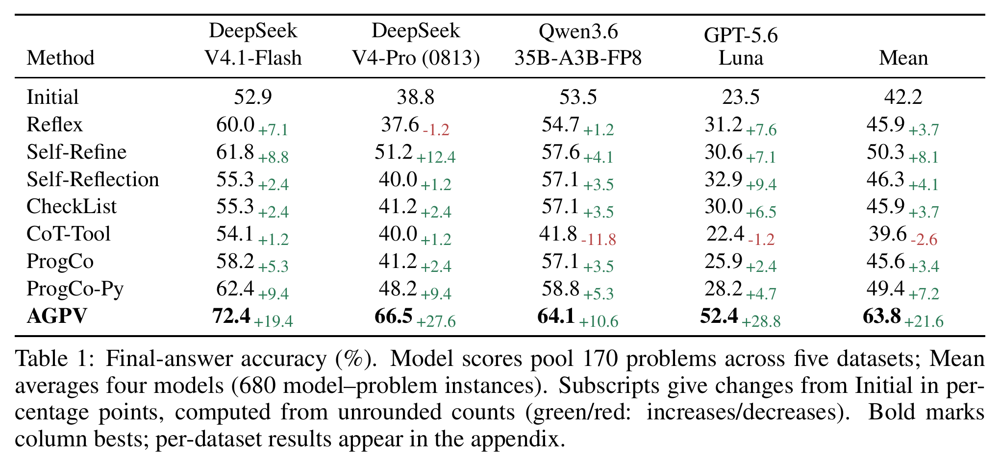

# AGPV：用于数学自纠错的智能体引导过程验证

**Agent-Guided Process Verification for Mathematical Self-Correction**

数学解答中，一步推导出错可能影响后续步骤，只检查最终答案还可能漏掉需要讨论的情况。AGPV 把解答拆成一组按顺序排列的关键判断，逐一检查推导、计算、题目约束以及解是否完整。发现第一个错误后，模型根据验证结果，从出错处重新推导。

## 方法框架

[](assets/framework.png)

给定题目和当前解答，模型列出关键判断并制定验证计划，必要时调用数学工具。所有判断都通过时接受当前解答。如果某一步未通过，系统汇总出错位置和依据，交给纠错智能体修正。答案改变后重新制定验证计划；答案保持不变时，更新原有的检查步骤再验证。解题过程中，同一题可以复用已成功的工具计算，过长的上下文会被压缩。

## 主要结果

[](assets/main-results.png)

## 安装与环境配置

在仓库根目录执行：

```bash
python -m pip install -r requirements.txt
```

示例调用 DeepSeek 官方 API。请设置 `DEEPSEEK_API_KEY`。PowerShell 使用 `$env:DEEPSEEK_API_KEY = "<your-key>"`，Bash 使用 `export DEEPSEEK_API_KEY="<your-key>"`。

## 快速开始

仓库附带的 `demo` 包含两道数学题。执行下面两步会调用模型。

### 1. 生成公共初答

```bash
python 0-1_initial_response/generate_initial_responses.py --dataset demo --output-dir runs/initial
```

初答保存在本地 `runs/initial/deepseek-flash_demo_first_response.jsonl`，评分保存在同目录的 `demo.initial-eval.json`。比较不同方法时可共用这批初答，在第 2 步用 `--initial-dir` 指向保存初答和版本记录的目录。

### 2. 运行 AGPV 并评分

```bash
python 0-3_all_model_test/run_plan_S_SC/S_SC_S3-1-2_forward+compress/run_agpv.py --dataset demo --initial-dir runs/initial --run
```

程序读取初答，启动本地 Python 工具并执行过程验证与纠错。每次运行默认写入 `runs/<UTC时间戳>/`。其中 `model_outputs/demo.json` 保存逐题推理和最终回答，`evaluation.json` 保存统一评分结果。参考答案仅用于评分。Python 工具会在本机执行模型生成的代码，请使用专用、低权限的环境。

要改跑 HMMT，请先按 `0-0_datasets/README.md` 准备题集，再将两步命令中的 `--dataset demo` 换成 `--dataset hmmt_feb_2025`。

部分验证与纠错代码改编自 ProgCo，详见[来源说明](THIRD_PARTY.md)。

## 引用

arXiv 链接待补。

```bibtex
@misc{zou2026agpv,
  title = {Agent-Guided Process Verification for Mathematical Self-Correction},
  author = {Zou, Rui and Wei, Mengqi and Zhao, Xin and Wen, Ji-Rong},
  year = {2026}
}
```
