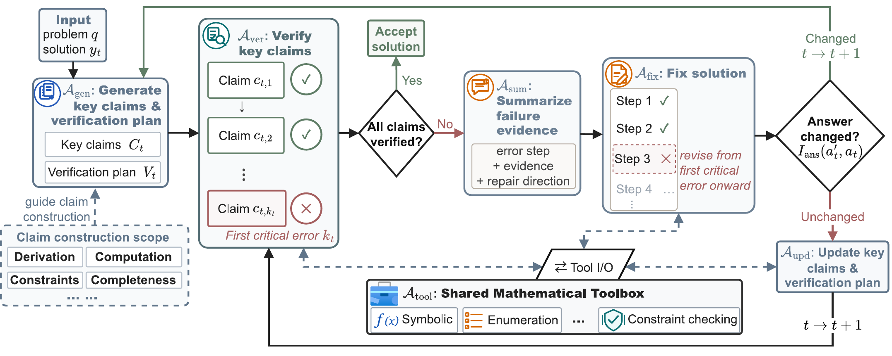

# AGPV: Agent-Guided Process Verification for Mathematical Self-Correction

English | [简体中文](README_zh-CN.md)

In a mathematical solution, an incorrect step can affect subsequent steps, and checking only the final answer may miss cases that need to be considered. AGPV decomposes a solution into an ordered sequence of key claims and checks the reasoning, computations, problem constraints, and completeness of the solution. Once the first error is found, the model uses the verification results to re-derive the solution from that point.

## Framework

[](assets/framework.png)

Given a problem and the current solution, the model lists key claims and develops a verification plan, using mathematical tools when needed. The current solution is accepted when all claims pass. If a step fails, the system summarizes the error location and supporting evidence for the correction agent to revise the solution. When the answer changes, the system creates a new verification plan. When the answer stays the same, the system updates the existing verification steps and checks again. Successful tool computations can be reused within the same problem, and overly long contexts are compressed.

## Main Results

[](assets/main-results.png)

## Installation and Configuration

Run the following command from the repository root:

```bash
python -m pip install -r requirements.txt
```

The example uses the official DeepSeek API. Set `DEEPSEEK_API_KEY`. In PowerShell, use `$env:DEEPSEEK_API_KEY = "<your-key>"`; in Bash, use `export DEEPSEEK_API_KEY="<your-key>"`.

## Quick Start

The included `demo` contains two mathematics problems. The following two steps call the model API.

### 1. Generate Shared Initial Responses

```bash
python 0-1_initial_response/generate_initial_responses.py --dataset demo --output-dir runs/initial
```

Initial responses are saved locally to `runs/initial/deepseek-flash_demo_first_response.jsonl`, and their scores are saved to `demo.initial-eval.json` in the same directory. When comparing methods, you can share this batch of initial responses. In step 2, set `--initial-dir` to the directory containing the initial responses and model version records.

### 2. Run AGPV and Evaluate

```bash
python 0-3_all_model_test/run_plan_S_SC/S_SC_S3-1-2_forward+compress/run_agpv.py --dataset demo --initial-dir runs/initial --run
```

The program reads the initial responses, starts the local Python tool, and performs process verification and correction. By default, each run is saved to `runs/<UTC-timestamp>/`. The file `model_outputs/demo.json` contains per-problem reasoning and final responses, and `evaluation.json` contains the results from the shared evaluator. Reference answers are used only for evaluation. The Python tool executes model-generated code on your machine, so use a dedicated environment with restricted permissions.

To run HMMT, first prepare the dataset as described in `0-0_datasets/README.md`, then replace `--dataset demo` with `--dataset hmmt_feb_2025` in both commands.

Parts of the verification and correction code are adapted from ProgCo. See [attribution](THIRD_PARTY.md).

## Citation

arXiv link to be added.

```bibtex
@misc{zou2026agpv,
  title = {Agent-Guided Process Verification for Mathematical Self-Correction},
  author = {Zou, Rui and Wei, Mengqi and Zhao, Xin and Wen, Ji-Rong},
  year = {2026}
}
```
